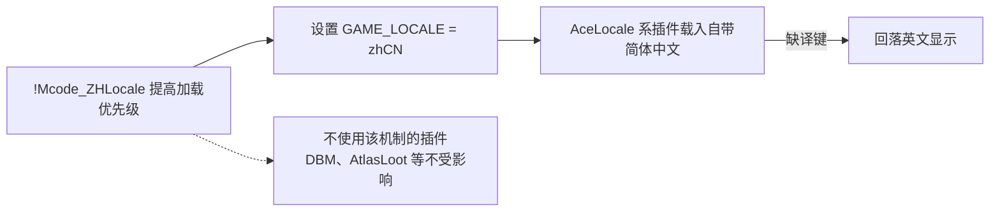

# !Mcode_ZHLocale —— 中文本地化驱动

  

在 enUS 客户端上启用 AceLocale 系插件自带的简体中文界面译文（AceLocale 官方预留的 GAME_LOCALE 覆盖口），缺译自动回落英文；无中文数据的插件（DBM、AtlasLoot 等）不受影响。

## 安装

1. 在本页点击 `Code` → `Download ZIP`，解压后把得到的文件夹（如 `!Mcode_ZHLocale-main`）改名为 `!Mcode_ZHLocale`——`!` 前缀用于提高加载优先级，请保留目录名。
2. 放入游戏目录下的 `Interface\AddOns\`（没有这两个文件夹就新建；游戏目录即 Wow.exe 所在文件夹）。
3. 在插件列表保持勾选。整包同步或覆盖 AddOns 目录时本插件可能被同名目录覆盖，之后界面回到英文——重新复制插件目录即可恢复。

## 禁用

在 ACP 或角色选择插件列表取消勾选并 `/reload`，停止由本驱动设置 `GAME_LOCALE="zhCN"`。之后语言由各插件自身译文和配置决定；汉化 MPQ 与其他插件的中文不由它撤销，不能保证整个界面回到英文。

## 维护

- 维护真源：本目录（工程内 `src/addons/!Mcode_ZHLocale`）；成品副本由刷新工具生成到 `src/addons/addons/`。
- 完整玩家说明：工程 `doc/玩家/中文界面驱动说明.md`。
